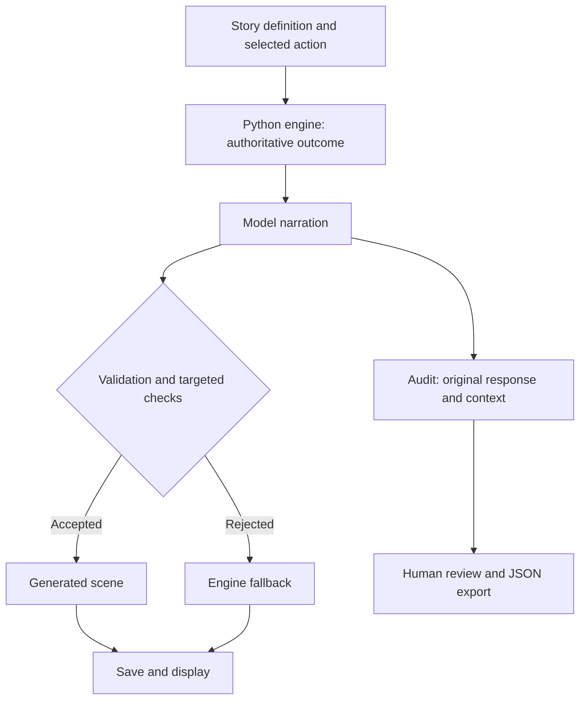

# StoryDoor

Two interactive mysteries with AI narration, deterministic story rules, local saves, and inspectable narration evaluations. Built by Jorge Arenas in collaboration with ChatGPT/Codex.

## Why this project

An AI narrator can produce convincing prose while changing the facts. StoryDoor makes those errors visible: Python owns the choices and consequences, rejected responses remain inspectable, and human review captures problems that text checks miss.

**Start here:** [Evaluation case study](docs/EVALUATION_CASE_STUDY.md) · [Demo guide](docs/DEMO_GUIDE.md) · [Automated tests](.github/workflows/tests.yml)

**Stack:** Python, Streamlit, Groq, Pydantic, SQLite, pytest.

## Stories

- **The Forgotten House:** four decisions, name and release-word clues, three endings.
- **The Last Signal:** five decisions at a coastal radio station; timing, equipment, and position clues; rescue requires both coordinates and a safe frequency. Three endings.

The second story is a new draft created for this project, not adapted from an existing manuscript. Both stories live in `stories/*.json`. Their opening actions, investigations, clue requirements, conditional outcomes, and endings use the same Python engine. This is a reusable staged branching format, not an unrestricted narrative generator.

## Run on Windows

Use Python 3.12 or 3.13 and a virtual environment.

```powershell
python -m venv .venv
.\.venv\Scripts\Activate.ps1
python -m pip install -r requirements.txt
Copy-Item .env.example .env
# Add your own Groq key to .env (never commit it).
python -m streamlit run app.py --server.port 8502
```

For an existing installation, skip creating the virtual environment and copying `.env.example`; preserve your `.env`, virtual environment, `storydoor.db`, and `evaluations.db`. Restart Streamlit after replacing source files. Original house saves remain readable. Select a story in the sidebar, check **Replace my current saved journey**, then click **Start selected story**. This works during a journey as well as after an ending. Selecting a title alone leaves your current progress in place. Replacing the one local save requires a checkbox. Download a completed story before replacing it if you want to keep its transcript.

## Evaluation

Open **Evaluation** in the sidebar after making a decision. Each attempted model call records story/action/history, full prompt and context, prompt version and story-inclusive hash, requested model, latency, original response, targeted check findings, and displayed fallback. API failures are counted separately. Missing credentials fail before a model attempt and are not recorded. Saving an audit record is required before advancing the game; failure to save game progress afterward can leave an audit attempt that was never committed to the journey.

Review the **original** response, not just the fallback. Mark pass/fail/pending and add notes. Inspect causal order, premature revelations, invented objects, and omitted consequences. Export the selected group as JSON. The group table supports comparison by story, model, and prompt version/hash, but differing paths or small sample sizes are not controlled experiments. No automated LLM judge is used.

Fallback rate uses returned responses as its denominator and excludes API errors. A passing automated check means no targeted pattern fired; it does not establish story correctness. Pattern checks can also reject harmless mentions or miss paraphrases.

```powershell
python -m pytest -q
python evaluate_regressions.py
```

Tests and the regression command use no live API calls. The thirteen offline fixtures include known failures, clean controls, and a deliberately undetected reversal of Elias's rescue. A zero regression count means detector behavior matched expectations, **not** that all fixture scenes are correct. `regression-report.json` identifies the known semantic miss. Fixtures are curated examples based on development observations, not a representative benchmark.

For a meaningful prompt comparison, keep model, story, action paths, sampling settings, and review rubric fixed; collect multiple responses per path for each prompt version. These exports are native StoryDoor JSON; an EvalForge adapter has not yet been built.

## Architecture



API failures stop advancement and are logged separately. This diagram shows the path when a response is returned.

`evaluation.py` records original responses independently of the save slot. `story_config.py` retains compatibility names for the original house. Loading a save reconstructs state from valid choices and restores stored scenes without calling Groq. Scene text is structurally validated on load, not semantically regraded. Save revisions prevent an older tab from overwriting newer progress.

`storydoor.db` holds one shared local save; `evaluations.db` holds local attempt history and human reviews. Both are excluded from Git. This is a local portfolio app, not a multi-user hosted service: no accounts or per-user storage isolation. Logs retain generated text and prompt context; export intentionally. No API key is stored in audit records.

## Validation and limits

The current package has **61 passing automated tests** in the build environment. Tests cover story paths, audit records, fallback behavior, save migration, and Streamlit AppTest flows. Model calls in automated tests are mocked. Live tests supplied the committed evaluation exports; they do not establish a general narration accuracy rate.

The GitHub workflow runs pytest and the offline regression suite on Ubuntu/Python 3.12 and Windows/Python 3.13 after pushes and pull requests. No Groq secret is required for CI. The workflow is prepared but its first hosted run remains to be verified after publication. Action setup follows the official [checkout](https://github.com/actions/checkout) and [setup-python](https://github.com/actions/setup-python) documentation.

A fixed model API setup is retained; arbitrary model compatibility is not claimed. The application has one local save slot and no account isolation. Automated checks cannot guarantee plot continuity or prose quality.

## Collaboration

Jorge set the product direction, chose the interactive-fiction format, ran the application, supplied actual model failures, and verified changes. Codex assisted with implementation, refactoring, regression fixtures, and tests. Continuity errors led to concrete design choices: Python owns consequences; prior generated prose is not authoritative; rejected text remains available for review; human semantic judgment remains explicit.

## Version 2.1

See `docs/PATCH_2_1.md` for the live baseline findings, typography and clock fixes, clarified rescue outcome, and repeat-run instructions. The original export is preserved under `data/baselines/`.
